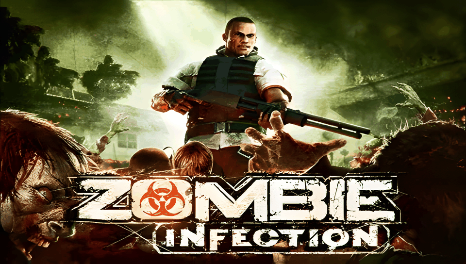

<h1 align="center">
  <br>
  Zombie Infection · PS Vita Port
</h1>

<p align="center">
  <b>Native port of Zombie Infection (Gameloft, iOS 1.0.0) for PlayStation Vita and PlayStation TV.</b>
</p>

<p align="center">
  
  
  
  
  
  
</p>

<p align="center">
  <a href="#-description">Description</a> •
  <a href="#-features">Features</a> •
  <a href="#-controls">Controls</a> •
  <a href="#-installation">Installation</a> •
  <a href="#-known-issues">Known Issues</a> •
  <a href="#-building-from-source">Build</a> •
  <a href="#-credits">Credits</a>
</p>

---

## 📖 Description

An unofficial, native **iOS-to-PS Vita wrapper port** of *Zombie Infection* (originally developed by **Gameloft**). Unlike the Android ports, there is no `.so` here: this port ships its own **Mach-O loader** that maps the official iOS ARM executable (`ZombieInfection`, from the 1.0.0 IPA) into PS Vita RAM and replaces the Apple frameworks it uses (Foundation, UIKit, CoreGraphics, CoreAudio, OpenGL ES) with native implementations on top of **vitaGL**, **OpenAL Soft**, **FreeType** and the Vita system libraries. The game itself is built on the **Irrlicht** engine, which the loader runs untouched.

---

## 🎮 Status & Playability

**Status: Playable (beta) (v1.1, VPK `01.10`)**

The game boots, runs its C++ global constructors, initializes Irrlicht, reaches the in-engine intro and the tutorial/gameplay on physical PlayStation Vita hardware. Known performance problems remain in some zones (see [Known Issues](#-known-issues)). Release notes are in [`RELEASE.md`](RELEASE.md).

- [x] **Mach-O loader**: loads the iOS ARM executable at a fixed base (`MACHO_SLIDE = 0x98000000`), applies **61,828** rebase words (non-PIE image, including `-mdynamic-no-pic` literal pools and switch tables in `__text`), resolves **7,358** import slots, runs the **366** global constructors, and enters the main game loop. *Verified on console.*
- [x] **Graphics**: GLES 1.x → **vitaGL** (compiled with `SOFTFP_ABI=1`). The game renders into a 320×480 portrait framebuffer that is rotated and scaled to the Vita's 960×544 screen. 3D gains field of view at the sides with correct proportions; the HUD/menus keep their original size, centered. Apple **CgBI** PNG textures are decoded natively. *Verified on console.*
- [x] **Touch & Controls**: front touchscreen provides full touch input. Physical buttons and the left stick drive the game's own **rearrangeable HUD** controls (read at runtime, so player layout is respected). *Verified on console.*
- [x] **Camera**: the right stick emulates one continuous touch-drag (the Shadow Guardian model) with a dead zone and response curve; sensitivity 1–10 via **Select + D-Pad ↑/↓**, persisted to `ux0:data/zombieinfection/camera_sens.txt`. *Verified on console.*
- [x] **Text & Fonts**: in-game text uses Irrlicht bitmap fonts (`gll_font.pak`); UIKit text (`sizeWithFont:`/`drawAtPoint:`) is backed by FreeType.
- [x] **Audio**: the game uses **OpenAL** (not RemoteIO), mapped to openal-soft on `sceAudioOut`; ADPCM is decoded by the game itself. AudioSession calls are stubbed.
- [x] **Saves**: progress is written under `ux0:data/zombieinfection/saves/` (iOS `Documents/` is redirected and normalized).
- [x] **Videos**: hardware-accelerated H.264 cutscene video playback (`SceVideodec` / `sceAvcdec`) with software AAC decoding via FFmpeg (`libavcodec`). Videos (`cinematic_02_lab.m4v` and `cinematic_03_fin.m4v`) play with audio and can be skipped with Cross (✖), Circle (●), or Start. *Verified on console.*
- [x] **Graphics polish**: eliminated geometry tearing and texture artifacts by cleaning vitaGL compilation flags (no speedhack regressions), expanding generic matrix stack depth to 16, and activating a 64-entry patched vertex program cache.
- [x] **Offline bypasses**: App Store, network and anti-piracy checks are gracefully bypassed.

---

## ✨ Features

| Feature | Status | Notes |
| :--- | :---: | :--- |
| Boots to gameplay | ✅ | Irrlicht init, in-engine intro and tutorial/gameplay reached on hardware |
| Graphics / renderer | ✅ | GLES 1.x → vitaGL; 320×480 portrait framebuffer scaled to 960×544; CgBI textures |
| Audio & music | 🧪 | OpenAL → openal-soft on `sceAudioOut`; cutscene audio verified, game audio not separately recorded |
| Video / cutscenes | ✅ | `cinematic_02_lab.m4v` and `cinematic_03_fin.m4v` with hardware H.264 and FFmpeg AAC; skippable |
| Physical buttons | ✅ | Drive the game's own rearrangeable HUD controls (see [Controls](#-controls)) |
| Analog sticks / camera | ✅ | Left stick movement; right stick camera drag with sensitivity 1–10 |
| Touch screen | ✅ | Full touch UI at all times |
| Button remapping / port menu | 🧪 | SELECT + START options menu (filter, FPS counter and limit); not yet tested on console |
| Save data | 🧪 | Saves under `ux0:data/zombieinfection/saves/`; not separately recorded as verified |
| Native trophies | ❌ | Not implemented |
| Languages | ❔ <!-- TODO: verify --> | Not documented in this repo |
| Performance | 🟡 | Severe drops to about 6 FPS in specific zones and cutscenes (under investigation) |
| Online / IAP / ads | ➖ | Store, networking and anti-piracy checks bypassed by design |
| PS TV | 🧪 | Same target as Vita per the description; not separately verified |

Legend: `✅ Working (verified on console) · 🧪 Implemented, not yet verified on console · 🟡 Partial · ❌ Not working · ➖ Not applicable · ❔ Not documented yet`

---

## 🎯 Controls

| Input | Action | Status |
| :---: | :--- | :---: |
| **Front Touchscreen** | Full touch UI at all times (menus, HUD) | ✅ Working |
| **Left Stick** | Movement (virtual analog stick on the game's HUD) | ✅ Working |
| **Right Stick** | Camera look (emulated touch-drag) | ✅ Working |
| **Cross (✖) / R** | Attack | ✅ Working |
| **Square (◼)** | Secondary attack | ✅ Working |
| **Circle (●)** | Use / contextual action | ✅ Working |
| **Triangle (▲)** | Jump | ✅ Working |
| **D-Pad Up** | Rotate (180° quick turn) | ✅ Working |
| **D-Pad Down** | Holster / unDraw weapon (guardar arma) | ✅ Working |
| **D-Pad Left** | Heal (use medikit) | ✅ Working |
| **D-Pad Right** | Reload weapon | ✅ Working |
| **L Trigger** | Dodge (or reload if no dodge active) | ✅ Working |
| **Start / Select** | Pause menu / Resume | ✅ Working |
| **L + R (held)** | Show / hide the on-screen touch controls | ✅ Working |
| **Select + D-Pad ↑/↓** | Camera sensitivity (1–10, saved) | ✅ Working |
| **Select + Start** | Options menu (see below) | 🧪 Not yet tested on console |
| **L + R + Triangle** (during gameplay) | Debug shortcut: trigger the video playback check | 🧪 Not yet verified on console |

> [!TIP]
> The touch controls are hidden (0% opacity) by default because physical buttons drive them; hold **L + R** to toggle them fully visible.

---

## 📋 Prerequisites

1. **CFW & Plugins**: PS Vita on Custom Firmware (**Enso 3.60 / 3.65** recommended) with `kubridge` under `*KERNEL` in `ur0:tai/config.txt`:
   ```ini
   *KERNEL
   ur0:tai/kubridge.skprx
   ```
2. **Shader Compiler**: `libshacccg.suprx` must be in `ur0:data/` (extract it with **ShaRKBR33D**).
3. **Game Files**: a decrypted **Zombie Infection 1.0.0** iOS `.ipa` (FairPlay `cryptid 0`). Open it as a ZIP and extract `Payload/ZombieInfection.app/`.

---

## 📦 Installation

1. Install `zombieinfection.vpk` with VitaShell.
2. Copy the game to `ux0:data/zombieinfection/`:
   ```
   ux0:data/zombieinfection/
     ZombieInfection.app/   the whole .app folder from the IPA, untouched
     rebase.bin             generated from the executable (see "Build Instructions")
     saves/                 created automatically — your save games
     logs/                  created automatically — log_001.log … log_999.log, one per run
   ```

### Options Menu (SELECT + START)

> [!NOTE]
> New in this build and **not yet tested on console**.

Press **SELECT + START** together at any time to pause the game and open the port's options panel. **D-Pad ↑/↓** picks a row, **←/→ or Cross** changes it, **Circle / Start** saves and closes. Settings are saved in `ux0:data/zombieinfection/options.txt`.

| Option | Values |
| :--- | :--- |
| **On-screen controls (L+R)** | Shown / Hidden (same as L + R) |
| **Screen filter** | Bilinear (smooth) · Sharp bilinear (integer pre-scale, crisp) · Pixel (nearest) |
| **FPS counter** | Off / On (top-left corner) |
| **FPS limit** | Off (game pace) / 30 FPS cap |

No screen-size option: the widescreen field-of-view mode needs the full 960×544 image.

---

## 🐛 Known Issues

- **Severe FPS drop (~6 FPS) in specific zones**: Certain areas and in-engine cutscenes (such as the park/helicopter area) suffer from severe framerate drops to ~6 FPS (under active investigation).
- **In-engine intro cutscene**: The game opening is an in-engine real-time 3D cutscene rendered by the engine (not a pre-rendered video file) and is affected by the framerate drop. Hardware H.264 video playback is implemented for the actual `.m4v` files (`cinematic_02_lab.m4v` and `cinematic_03_fin.m4v`).
- **Online features disabled**: store, networking and anti-piracy checks are bypassed by design.
- **Crash dumps** are written by the system to `ux0:data/` (not to the game folder).

---

## 🔨 Building from Source

### Prerequisites

- [VitaSDK](https://vitasdk.org/) (`$VITASDK`) with `vitaGL` (vendored), `vitashark`, `openal-soft`, `freetype`, `libpng` and `zlib`.
- CMake 3.14+, Python 3 (for the tools).
- The decrypted `ZombieInfection.app` folder, linked as `game_app` in the repo root (never committed).

### Compilation Commands

```bash
git clone https://github.com/MetalSyntax/Zombie-Infection-vita.git
cd Zombie-Infection-vita
ln -s /path/to/Payload/ZombieInfection.app game_app

# Stage the console data (copies the .app untouched + generates rebase.bin)
tools/stage_data.sh

# Build eboot.bin / zombieinfection.vpk
cmake -S . -B build -DCMAKE_BUILD_TYPE=Debug
cmake --build build
```

### Deploy & Debug (over VitaShell FTP)

```bash
python3 -I tools/deploy_data.py          # incremental upload of ux0_data/zombieinfection/ (never touches saves/)
python3 -I tools/deploy_data.py --logs   # fetch logs/log_NNN.log and crash dumps into ./logs/
```

A crash PC in `0x98xxxxxx` minus `0x98000000` is the address in the Mach-O: inspect it with `tools/annotate.py game_app/ZombieInfection <symbol>`. Architecture and progress notes: [`PORTING_PLAN.md`](PORTING_PLAN.md).

## 📁 Project Structure

- `source/`: loader and runtime (Mach-O loader, GLES → vitaGL, FFmpeg video and AAC, OpenAL, input, options menu).
- `tools/`: `stage_data.sh`, `deploy_data.py` (FTP), `annotate.py`.
- `vendor/vitaGL/`: vitaGL built from source (softfp).
- `extras/livearea/`: LiveArea assets.
- `PORTING_PLAN.md`: architecture and porting plan. `port_progress.md`: bug-by-bug progress log.
- `RELEASE.md`: release notes (v1.1).

---

## 📜 Disclaimer

**Zombie Infection** is a registered trademark of **Gameloft**. The work presented in this repository is unofficial and is not produced, endorsed, or sanctioned by Gameloft or any affiliated entities.

This software does NOT contain original game code, binaries, copyrighted graphics, or game assets. The authors do not promote or condone piracy in any way. To play, you must provide your own legally obtained, **decrypted** copy of the iOS `.ipa`.

---

## ☕ Support My Work

This project is **free** and will stay free. If you enjoy it, a tip from **$1** helps me keep porting games to the PS Vita:

<p align="center">
  <a href="https://ko-fi.com/metalsyntax"></a>
</p>

- **Ko-fi:** [ko-fi.com/metalsyntax](https://ko-fi.com/metalsyntax)
- **PayPal:** [paypal.me/MetalSyntax](https://paypal.me/MetalSyntax)
- **Bitcoin (BTC):** `133HdCsaWxdjTfmwpgGVykByhNBV338uRc`

**Ko-fi supporters get:**
- **Early access** to new ports before their public release (test builds of upcoming projects).
- **Data preparation scripts and step-by-step guides** to set up your own game files for each new port.
- A say in which games I port next.

> Game files are never distributed. You always need your own legally obtained copy of the game.

---

## 👥 Credits

- **Zombie Infection** is intellectual property of **Gameloft**, built on the **Irrlicht** engine.
- **vitaGL** graphics library by [Rinnegatamante](https://github.com/Rinnegatamante/vitaGL).
- **kubridge** plugin by [Bythos](https://github.com/bythos14/kubridge).
- **OpenAL Soft**, **FreeType**, **libpng** and **zlib** projects.
- The **iOS Mach-O loader** is based on [`ios-loader-boilerplate`](https://github.com/MetalSyntax/ios-loader-boilerplate) and the [Inotia 2 port](https://github.com/MetalSyntax/Inotia2-vita) case study.
- Special thanks to the PS Vita homebrew and porting community.

---

## 📄 License

No `LICENSE` file is present in this repository. <!-- TODO: add a LICENSE file and state the loader license. -->
