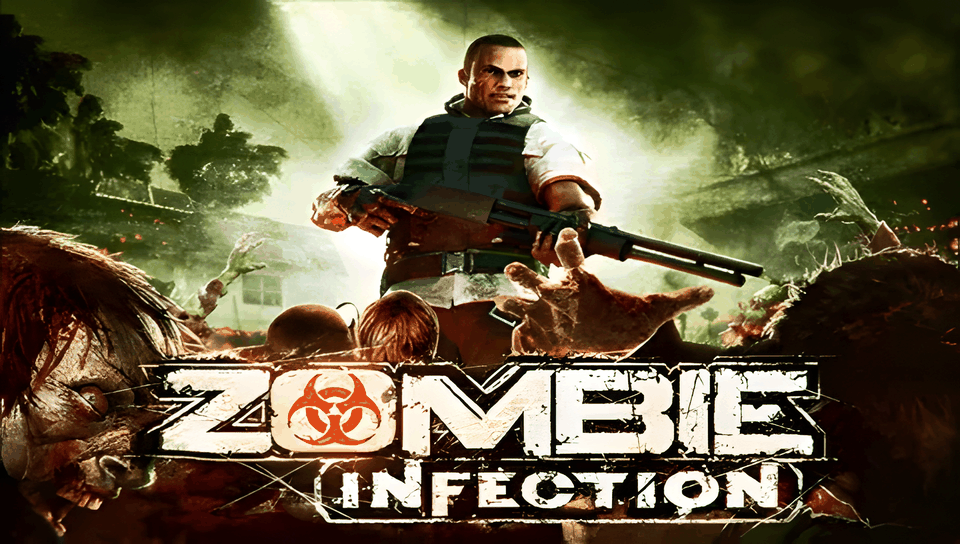

<h1 align="center">
  <br>
  Zombie Infection · PS Vita Port
</h1>

<p align="center">
  <a href="#-status--playability">Status & Playability</a> •
  <a href="#setup-instructions-for-players">How to install</a> •
  <a href="#controls">Controls</a> •
  <a href="#known-issues">Known Issues</a> •
  <a href="#build-instructions-for-developers">How to compile</a> •
  <a href="#credits--acknowledgments">Credits</a>
</p>

An unofficial, native **iOS-to-PS Vita wrapper port** of *Zombie Infection* (originally developed by **Gameloft**). Unlike the Android ports, there is no `.so` here: this port ships its own **Mach-O loader** that maps the official iOS ARM executable (`ZombieInfection`, from the 1.0.0 IPA) into PS Vita RAM and replaces the Apple frameworks it uses (Foundation, UIKit, CoreGraphics, CoreAudio, OpenGL ES) with native implementations on top of **vitaGL**, **OpenAL Soft**, **FreeType** and the Vita system libraries. The game itself is built on the **Irrlicht** engine, which the loader runs untouched.

---

## 🎮 Status & Playability

**Status: PLAYABLE (beta)**

The game boots, runs its C++ global constructors, initializes Irrlicht, reaches the in-engine intro and the tutorial/gameplay on physical PlayStation Vita hardware.

- [x] **Mach-O loader**: loads the iOS ARM executable at a fixed base (`MACHO_SLIDE = 0x98000000`), applies **61,828** rebase words (non-PIE image, including `-mdynamic-no-pic` literal pools and switch tables in `__text`), resolves **7,358** import slots, runs the **366** global constructors, and enters the main game loop. *Verified on console.*
- [x] **Graphics**: GLES 1.x → **vitaGL** (compiled with `SOFTFP_ABI=1`). The game renders into a 320×480 portrait framebuffer that is rotated and scaled to the Vita's 960×544 screen. 3D gains field of view at the sides with correct proportions; the HUD/menus keep their original size, centered. Apple **CgBI** PNG textures are decoded natively. *Verified on console.*
- [x] **Touch & Controls**: front touchscreen provides full touch input. Physical buttons and the left stick drive the game's own **rearrangeable HUD** controls (read at runtime, so player layout is respected). *Verified on console.*
- [x] **Camera**: the right stick emulates one continuous touch-drag (the Shadow Guardian model) with a dead zone and response curve; sensitivity 1–10 via **Select + D-Pad ↑/↓**, persisted to `ux0:data/zombieinfection/camera_sens.txt`. *Verified on console.*
- [x] **Text & Fonts**: in-game text uses Irrlicht bitmap fonts (`gll_font.pak`); UIKit text (`sizeWithFont:`/`drawAtPoint:`) is backed by FreeType.
- [x] **Audio**: the game uses **OpenAL** (not RemoteIO), mapped to openal-soft on `sceAudioOut`; ADPCM is decoded by the game itself. AudioSession calls are stubbed.
- [x] **Saves**: progress is written under `ux0:data/zombieinfection/saves/` (iOS `Documents/` is redirected and normalized).
- [ ] **Videos**: `.m4v` cutscenes are currently skipped (next step: `SceAvPlayer`).
- [ ] **Graphics polish**: occasional distorted geometry/textures during in-engine cutscenes are still under investigation.
- [x] **Offline bypasses**: App Store, network and anti-piracy checks are gracefully bypassed.

---

## Disclaimer

**Zombie Infection** is a registered trademark of **Gameloft**. The work presented in this repository is unofficial and is not produced, endorsed, or sanctioned by Gameloft or any affiliated entities.

This software does NOT contain original game code, binaries, copyrighted graphics, or game assets. The authors do not promote or condone piracy in any way. To play, you must provide your own legally obtained, **decrypted** copy of the iOS `.ipa`.

---

## Setup Instructions (For Players)

1. **CFW & Plugins**: PS Vita on Custom Firmware (**Enso 3.60 / 3.65** recommended) with `kubridge` under `*KERNEL` in `ur0:tai/config.txt`:
   ```ini
   *KERNEL
   ur0:tai/kubridge.skprx
   ```
2. **Shader Compiler**: `libshacccg.suprx` must be in `ur0:data/` (extract it with **ShaRKBR33D**).
3. **Game Files**: a decrypted **Zombie Infection 1.0.0** iOS `.ipa` (FairPlay `cryptid 0`). Open it as a ZIP and extract `Payload/ZombieInfection.app/`.
4. **Copy to the Vita** (`ux0:data/zombieinfection/`):
   ```
   ux0:data/zombieinfection/
     ZombieInfection.app/   the whole .app folder from the IPA, untouched
     rebase.bin             generated from the executable (see "Build Instructions")
     saves/                 created automatically — your save games
     logs/                  created automatically — log_001.log … log_999.log, one per run
   ```
5. **Install VPK**: install `zombieinfection.vpk` with VitaShell.

---

## Controls

| Input | Action | Status |
| :---: | :--- | :---: |
| **Front Touchscreen** | Full touch UI at all times (menus, HUD) | ✅ Working |
| **Left Stick** | Movement (virtual analog stick on the game's HUD) | ✅ Working |
| **Right Stick** | Camera look (emulated touch-drag) | ✅ Working |
| **Cross (✖) / R** | Attack | ✅ Working |
| **Square (◼)** | Secondary attack | ✅ Working |
| **Circle (●)** | Use / contextual action | ✅ Working |
| **Triangle (▲)** | Holster (hide guns) / jump | ✅ Working |
| **D-Pad Up** | Rotate | ✅ Working |
| **D-Pad Down** | Holster / unDraw weapon | ✅ Working |
| **L Trigger** | Reload weapon | ✅ Working |
| **Start / Select** | Pause menu / Resume | ✅ Working |
| **L + R (held)** | Show / hide the on-screen touch controls | ✅ Working |
| **Select + D-Pad ↑/↓** | Camera sensitivity (1–10, saved) | ✅ Working |

> [!TIP]
> The touch controls are hidden (0% opacity) by default because physical buttons drive them; hold **L + R** to toggle them fully visible.

---

## Known Issues

- **Severe FPS drop (~6 FPS) in specific zones**: Certain areas and in-engine cutscenes (such as the park/helicopter area) suffer from severe framerate drops to ~6 FPS (under active investigation).
- **In-engine intro cutscene**: The game opening is an in-engine real-time 3D cutscene rendered by the engine (not a pre-rendered video file) and is affected by the framerate drop. Hardware H.264 video playback is implemented for the actual `.m4v` files (`cinematic_02_lab.m4v` and `cinematic_03_fin.m4v`).
- **Online features disabled**: store, networking and anti-piracy checks are bypassed by design.
- **Crash dumps** are written by the system to `ux0:data/` (not to the game folder).

---

## Build Instructions (For Developers)

### Prerequisites

- [VitaSDK](https://vitasdk.org/) (`$VITASDK`) with `vitaGL` (vendored), `vitashark`, `openal-soft`, `freetype`, `libpng` and `zlib`.
- CMake 3.14+, Python 3 (for the tools).
- The decrypted `ZombieInfection.app` folder, linked as `game_app` in the repo root (never committed).

### Compilation Commands

```bash
git clone https://github.com/your-username/Zombie-Infection-vita.git
cd Zombie-Infection-vita
ln -s /path/to/Payload/ZombieInfection.app game_app

# Stage the console data (copies the .app untouched + generates rebase.bin)
tools/stage_data.sh

# Build eboot.bin / zombieinfection.vpk
cmake -S . -B build -DCMAKE_BUILD_TYPE=Debug
cmake --build build
```

### Deploy & Debug (over VitaShell FTP)

```bash
python3 -I tools/deploy_data.py          # incremental upload of ux0_data/zombieinfection/ (never touches saves/)
python3 -I tools/deploy_data.py --logs   # fetch logs/log_NNN.log and crash dumps into ./logs/
```

A crash PC in `0x98xxxxxx` minus `0x98000000` is the address in the Mach-O: inspect it with `tools/annotate.py game_app/ZombieInfection <symbol>`. Architecture and progress notes: [`PORTING_PLAN.md`](PORTING_PLAN.md).

---

## Credits & Acknowledgments

- **Zombie Infection** is intellectual property of **Gameloft**, built on the **Irrlicht** engine.
- **vitaGL** graphics library by [Rinnegatamante](https://github.com/Rinnegatamante/vitaGL).
- **kubridge** plugin by [Bythos](https://github.com/bythos14/kubridge).
- **OpenAL Soft**, **FreeType**, **libpng** and **zlib** projects.
- The **iOS Mach-O loader** architecture builds on the battle-tested [`ios-loader-boilerplate`](https://github.com/Rinnegatamante/soloader-boilerplate) work and the Inotia 2 port case study.
- Special thanks to the PS Vita homebrew and porting community.
